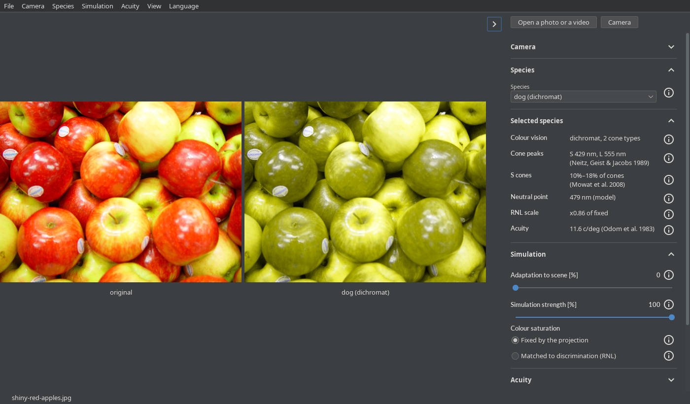

# Using dog-vision

What each program shows and how it is driven.\
Building them is [Building it](building.md)'s.

- [The Android app](#the-android-app) — the controls, the camera and its mirroring, a photo or a video,
  saving at full size, recording and the language.
- [The web page](#the-web-page) — what a browser needs for the camera, snapshots and recording.
- [The command line](#the-command-line) — converting a photo, `--species` and the other options.
- [The desktop window](#the-desktop-window) — `dog-vision-compose` in Compose and `dog-vision-swing` in Swing,
  their GL on Linux and Windows, and ffmpeg for a video or the camera.

## The Android app

The app opens on the back camera, with the scene as it is and as a dog sees it.


- **The button with two arrows switches to the next camera** the phone lists, the last to the first;
  it shows only where the phone has two cameras or more.
- **The front camera's image is shown mirrored**, as a mirror shows a face, and saved and recorded as shown;
  [The camera and its mirroring](#the-camera-and-its-mirroring) says how to change it.
- **The images are laid out to show them largest**: side by side on a wide screen,
  one above another on a tall one, each with a caption under it saying what it shows.
- **The controls are beside the images on a wide screen and under them on a tall one.**\
  The button with three sliders over the images hides or shows them.
- **Each control and each fact has an info button** that says what it means, in a few paragraphs.

### The controls

The controls are grouped in sections, and a tap on a section's title opens or closes it.\
The web page and the desktop window show the same ones.

| Control                       | Does                                                     |
|-------------------------------|----------------------------------------------------------|
| *Camera*                      | which camera is shown, or *Off*, which shows nothing     |
| *Mirroring*                   | whether the camera's image is mirrored                   |
| *Species*                     | picks the animal                                         |
| *Selected species*            | its cones, their sources, its RNL factors and its acuity |
| *Adaptation to scene [%]*     | adapts the cones to the scene instead of to daylight     |
| *Simulation strength [%]*     | blends the simulation with the original                  |
| *Colour saturation*           | how saturated the colours come out                       |
| *Blur to the species' acuity* | removes the detail finer than the species resolves       |
| *Image spans [degrees]*       | how wide the image is in degrees, which sets the blur    |
| *Side by side*                | a second image beside the simulation, or not             |
| *Compared with*               | the original, or another species, in that second image   |
| *Map of differences*          | a third image marking where the first two differ         |
| *Reset*                       | every control back to where it started                   |
| *Language*                    | the app's language; *As the system* follows the phone    |

What each control does to the picture, and from which measurements, is [The model](model.md)'s.

The controls, which camera is shown or that it is off, and the photo or video shown instead (a video from its start)
stay as they were when Android ends the app in the background to free memory.\
A photo or a video that cannot be read by then,
as when it was deleted meanwhile, gives way to the camera, and a message says so.

### The camera and its mirroring

The *Camera* section of the controls is the same in the app, the web page and both desktop windows;
in the app and the windows it starts closed.

- ***Camera* lists *Off* and every camera**:
  the app's by where they face, *Back camera*, *Front camera*, and *Camera N* for an external one;
  the web page's and the desktop window's by the names the browser or the system gives them.
- ***Off* stops the camera and shows nothing**, until a camera, a photo or a video is chosen.\
  While a photo or a video is shown, the camera is off already: the list shows *Off*, and choosing it changes nothing.
- ***Mirroring* is one choice for every camera**: *Mirror*, *Do not mirror*, or *Automatic*, which it starts on.
- ***Automatic* mirrors a camera that faces the viewer, and not one that faces away**,
  and says in brackets which it is: *Automatic (front)* or *Automatic (back)*.
- **Where the camera does not say where it faces, *Automatic* cannot be chosen**,
  and a choice of it is shown and acts as *Mirror*, as such a camera is most likely a webcam facing the viewer.\
  A camera that says brings *Automatic* back.
- **The camera cannot change while the view is recorded**, as the video's size would change; its mirroring can.

### A photo or a video instead of the camera

- **The picture button opens a photo or a video** through the system's photo picker, which needs no storage permission.
- **A photo is shown scaled down** to 1280 pixels on its longest side, so that the controls stay quick,
  and turned as its EXIF orientation says.
- **A video plays at its own rate, over and over, without its sound**,
  scaled down as a photo is and turned as its rotation says.
- **An HDR video is tone-mapped to SDR** as its conversion is,
  so that it looks as it will once saved, where the GPU can do it (with `GL_EXT_YUV_target`);
  where not, as on the emulator, it looks flat, its HDR frames taken as SDR.
- **The camera button goes back to the camera.**
- **A photo or a video can be opened without allowing the camera**, which the app asks for only to show it.

### Saving

Images go to *Pictures/Dog Vision* and videos to *Movies/Dog Vision*, where the gallery shows them:

- **The arrow button saves a snapshot** of the view as shown, at the size the images are rendered:
  the camera's resolution, or a photo's or a video's scaled-down view.\
  It is called `dog-<species>-<time>.png`, or `dog-<left>-vs-<species>-<time>.png` when another species is compared.
- **The corners button saves the photo or the video at its full size**,
  as the view shows it now, with the same name ending in `-full.png` or `-full.mp4`,
  as the system photo picker does not tell an app a file's name.\
  A message says how far it has got, and the cross that replaces the button meanwhile cancels it.
- **The conversion goes on in the background**, the app left or swiped away from the recent apps:
  a notification shows how far it has got, with a button that cancels it, and then where it was saved.\
  The first conversion asks whether the app may post notifications; without them, it runs all the same.
- **A photo is converted on the CPU.**
- **A video is converted by Media3's Transformer on the GPU**, with the original's sound:
  - it is encoded as H.265 where the phone has an encoder for it, and as H.264 where not;
  - it is scaled down, keeping its shape,
    where the encoder or the GPU cannot take the view's size, and the message says so;
  - an HDR video is tone-mapped to SDR first, since the model works on SDR;
    a GPU without `GL_EXT_YUV_target`, as the emulator's, cannot, and the conversion then fails.

Before Android 10, saving asks for the storage permission.

### Recording the view

- **The ring button records the view as shown**, every change included, until the square button stops it.
- **The video has 30 frames a second, without sound**, each frame repeated for as long as it was shown.
- **It is called `dog-<species>-<time>.mp4`** and goes to *Movies/Dog Vision*.
- **While it records, whatever would change the video's size is locked**:
  the source and the camera, *Side by side*, *Map of differences*, and the screen's orientation.
- **It stops when the app leaves the screen**, and the video recorded so far is saved.

### Language

- **The app speaks English and Czech.**
- **It starts in the phone's language**, and in English when the phone's is neither.
- **The *Language* choice at the end of the controls overrides it**,
  and so does the per-app language setting of Android 13 and later; Android remembers the choice.

## The web page


- **The built `index.html` opens as it is**, from the folder or from any static server:
  the page fetches nothing, and its wording is compiled into `dog-vision.js`.
- **On Linux it installs from the deb or the rpm `dog-vision-web`**, or with every other program from `dog-vision`,
  as *Dog Vision (web)* in the desktop's menu, which opens the installed `index.html` in the system's browser.
- **On Windows the MSI installs it**, as its part *GUI (web browser)*,
  with *Dog Vision (web)* in the Start menu, which opens the installed `index.html` in the system's browser.\
  [Building it](building.md#what-each-package-holds) says what each installs.
- **The script's source map is installed apart**, for a browser's developer tools to show the Kotlin sources:
  the deb or the rpm `dog-vision-web-sourcemap`, or the MSI's part *Source map*, which is not selected by default.
- **The browser needs WebGL 2**; without it the page says so.
- **Its wording is English or Czech**, as chosen at the end of its panel,
  which the browser remembers, or else the browser's language where there are strings for it.

### A photo or a video

- **Open a photo or a video opens either**, as does dropping one on the images.
- **A photo is scaled down to 1280 pixels** on its longest side, as the app's is.
- **A video plays over and over without its sound**,
  scaled down as a photo is, turned as its file says, and paused while the page is hidden.
- **What plays is what the browser decodes**: its codecs, and its own tone mapping of an HDR video.

### The camera

- **Camera starts the camera** when clicked, and the browser asks first whether the page may use it.
- **It shows the back camera first**,
  where the device tells them apart, asked for at 1280 x 720 as the app's frames are;
  a camera without 1280 x 720 gives the size it has nearest, such as 640 x 480.
- **Switch camera goes to the next camera the browser lists**;
  it shows only where the browser knows of two cameras or more.
- **The cameras are listed once the page may use a camera**: at once where it was allowed before,
  else after the first start; until then the browser names none, and the panel's *Camera* lists only *Off*.\
  A camera plugged in or out is listed or dropped as it happens; the last one unplugged stays listed.
- **A camera says where it faces through its `facingMode`**,
  which a phone's cameras report and a laptop's webcam often does not; [*Automatic*](#the-camera-and-its-mirroring) follows it.
- **The camera stops while the page is hidden**, and starts again when it is shown; opening a photo or a video stops it.

#### Caveat: the camera needs a secure context

The browser offers a camera only to a page served over `https:` or from `localhost`, or opened as a file,
which Chrome 154 and Firefox 156 count as one.\
Served over plain `http:` from elsewhere, the page shows no Camera button.

### Saving and recording

- **Save snapshot downloads the view as shown**, as a PNG named as the app names it,
  at the size the photo, the video's or the camera's frame is shown at;
  the photo and the video at full size are only the app's.
- **The snapshot needs `CompressionStream`**, which Chrome 80, Firefox 113 and Safari 16.4 are the first to have.
- **Record video records the view as shown** until Stop recording, as the app records it:
  the images at the size they are composed,
  in the arrangement they had at the start, without captions or sound, at up to 30 frames a second.
- **The browser saves it as `dog-<species>-<time>.mp4`**, or as `.webm` where it records no MP4:
  Chrome 154 records H.264 in MP4, Firefox 156 VP8 in WebM.\
  A WebM a browser records states no duration, so a player may not seek in it.
- **While it records, whatever would change the video's size is locked**:
  the source, the camera, *Side by side* and *Map of differences*.
- **It stops when the page is hidden**, and the video recorded so far is saved.

#### Caveat: Firefox on Android records no video of a file

In Firefox 156 on Android, a video's frames come out magenta in the recording. The camera and a photo record there.

## The command line

```sh
dog-vision-cli --species cat --compare dog photo.jpg            # from the deb or the rpm
dog-vision-cli --species cat --compare dog photo.jpg            # from the MSI, on Windows
dog-vision-cli\dog-vision-cli.exe --species cat photo.jpg       # from the zip, on Windows
java -jar dog-vision-cli.jar --species cat --compare dog photo.jpg
```

- **On Linux it installs as a package of its own, `dog-vision-cli`**, from its deb or its rpm,
  or with every other program from `dog-vision`,
  and runs as `dog-vision-cli` from the `PATH` on the system's Java 17 or newer,
  which the package manager installs with it where there is none; a headless Java is enough, as it opens no window.\
  Its JARs are the package `dog-vision-common`'s, which the windows' packages run on too.
- **On Windows the MSI installs it beside both windows**, as its part *Command line*, and puts it on the `PATH`,
  so that it runs as `dog-vision-cli` in a console opened after, on a Java it brings with it.\
  [Building it](building.md#what-each-package-holds) says what it installs.
- **Or as a zip, to unpack and run** as `dog-vision-cli\dog-vision-cli.exe`, which it adds to no `PATH`;
  [Building it](building.md#the-command-lines-zip-for-windows) says how it is made.
- **Anywhere else, the JAR runs on a Java 17 or newer**: `./gradlew :cli:uberJar` builds it, with everything it needs.
- **It converts a photo at full size**: it writes a PNG next to the photo, or into `--output-dir`,
  and says what share of the pixels differ when `--difference` asks for the map.
- **The PNG is named after the photo and the species it shows**:
  `photo.dog.png`, `photo.cat.png` with `--species cat`, and `photo.horse-vs-cat.png` with `--compare horse` too.
- **It takes options for the view**:
  `--species`, `--compare`, `--difference`, `--adaptation`, `--strength`, `--chroma-scale`, `--acuity` and `--fov`;
  `--help` lists them.\
  A video and the window are not in it.
- **A photo is turned as its EXIF orientation says.**
- **It speaks the system's language**, English or Czech, as gettext reads it:
  the list in `LANGUAGE`, such as `cs:en`, where it is set, or else `LC_ALL`, `LC_MESSAGES` or `LANG`,
  and on Windows the system's own; so do the windows.

## The desktop window

```sh
dog-vision-compose                          # the camera, /dev/video0 on Linux
dog-vision-compose photo.jpg                # a photo, or a video played over and over
dog-vision-compose --species cat --camera 1 # the cat's view of the second camera
```

It runs on Linux and Windows on x86-64.


- **On Linux it installs from the deb or the rpm `dog-vision-compose`**,
  or with every other program from `dog-vision`, as `dog-vision-compose` on the `PATH`
  and *Dog Vision (Kotlin Compose)* in the desktop's menu (*Jak vidí pes (Kotlin Compose)* in Czech),
  on the system's Java 17 or newer, which the package manager installs with it where there is none.\
  It recommends `dog-vision-cli`, the command line alone, which is a package of its own.
- **The tar.gz runs without installing**, unpacked anywhere, as `dog-vision-compose/bin/dog-vision-compose`,
  on a Java of its own; on Windows, the MSI installs it with one as well.
- **Its launcher takes the Java in `JAVA_HOME`**, else the one on the `PATH`,
  else the newest in `/usr/lib/jvm` or `/usr/lib64/jvm`, whichever is first 17 or newer and not headless.
- **It takes options of its own**: the command line's for the view it starts with and goes back to,
  `--camera` and `--gl`, but not `--output-dir`, as it saves nothing yet.\
  It converts no file: given one, it shows it.
- **`--help` lists them**, on the terminal on Linux,
  and on Windows, where the window has no console, in a window of its own, whose text can be selected and copied.\
  A command line it cannot read is said the same way.
- **A photo is scaled down to 1280 pixels** for the view, as the app's is.
- **Open a photo or a video opens another one** from the system's dialog, which starts in the folder of the file shown;
  the o key opens the dialog too, and a file dropped anywhere on the window opens as well.
- **On Linux the dialog is kdialog's on KDE and zenity's elsewhere**, whichever of the two is installed,
  and Java's own where neither is: Java's comes up behind the window on KDE from its second opening on.
- **Camera goes back to the camera** shown last, or else the one the command line names;
  the panel's [*Camera*](#the-camera-and-its-mirroring) picks another, or *Off*.
- **The cameras are listed again as the panel's list drops down**, so that one plugged in since shows;
  on Windows, where ffmpeg lists them, they come a moment after it opens.
- **F9 or the arrow at the images' edge hides the controls**, and the images take their room; the same again shows them.
- **q or Escape closes it**, but for while a list is dropped down, which then takes the key.
- **It has no menus, no settings, no snapshots and no recording yet.**

### The same window in Swing: `dog-vision-swing`

```sh
dog-vision-swing photo.jpg   # as dog-vision-compose, with the same options, keys and dialog
```



- **It shows what the Compose window shows, from the same state**, the `LiveSession` in [`gui-core`](../gui-core):
  the same images, drawn by the same passes, and the same controls, in Swing's own widgets with [FlatLaf](https://www.formdev.com/flatlaf/).
- **It needs neither Compose nor skiko**, so its packages leave out Compose's JARs and skiko's natives.
- **On Linux it installs from the deb or the rpm `dog-vision-swing`**, or with every other program from `dog-vision`,
  as `dog-vision-swing` on the `PATH` and *Dog Vision (Java Swing)* in the desktop's menu
  (*Jak vidí pes (Java Swing)* in Czech), beside `dog-vision-compose` where both are installed.\
  Its tar.gz runs as `dog-vision-swing/bin/dog-vision-swing`, and on Windows the MSI installs it,
  as its part *GUI (Java Swing)*, beside the Compose window's *GUI (Compose Multiplatform)*.
- **It is light or dark as the desktop asks**:
  on Linux as the desktop portal's colour scheme says, which GNOME and KDE set,
  on Windows as `AppsUseLightTheme` says, and light where neither can be read.
- **It draws the images at the screen's own pixels**,
  not at Swing's scaled ones, so that they are as sharp on a HiDPI screen as in the Compose window.

The sections below hold for both windows.

### The GPU it draws on

- **On Linux it needs EGL with Mesa's device platform** (`EGL_EXT_platform_device`) for an OpenGL ES 3 context,
  and takes the first device with a DRM render node;
  with none, it renders on the CPU and says so on its standard error.
- **On Windows it draws through ANGLE**, OpenGL ES 3 over Direct3D 11, as Chrome draws WebGL there; ANGLE comes with it.
- **Where ANGLE cannot start, WGL draws**, the graphics driver's own desktop OpenGL 3.3.\
  `--gl angle` or `--gl wgl` picks one alone.

### A video or the camera, through ffmpeg

- **A video or the camera comes through the system's `ffmpeg`**, which must be on the `PATH` with `ffprobe`;
  where either cannot run, the window says so in place of the video or the camera.
- **A video plays at its own speed**, without its sound, turned as its file says and scaled down as a photo is;
  an HDR video is not tone mapped.
- **`--camera N` is `/dev/videoN` on Linux**, through Video4Linux,
  and on Windows the Nth camera ffmpeg lists through DirectShow, counted from 0.
- **The camera is asked for Motion-JPEG at 1280 x 720**, which a USB webcam gives at 30 frames a second,
  and for whatever it gives where it has none.
- **The panel lists the cameras by the system's names**:
  on Linux each `/dev/videoN` as its driver names it, but a webcam's second node, which gives metadata, not frames;
  on Windows the cameras ffmpeg lists through DirectShow.
- **Only Linux can tell where a camera faces**,
  from the panel the firmware places its USB device or port on, which sysfs gives as `physical_location`;
  where the firmware places it on none, it is unknown, and so is every camera's on Windows.\
  Neither Video4Linux nor DirectShow says where a camera faces,
  so [*Automatic*](#the-camera-and-its-mirroring) is offered only where the firmware places the camera.

#### On Windows, the window offers to download ffmpeg

- **Windows has no ffmpeg of its own**, so the window offers to download it, with *Download ffmpeg*:
  BtbN's newest build of the release branch `ffmpeg-windows` in [`libs.versions.toml`](../gradle/libs.versions.toml) names,
  checked against the release's `checksums.sha256`.
- **It goes into `%ProgramData%\Dog Vision`**, which both windows take it from, for every user of the machine;
  uninstalling the MSI removes the folder, and upgrading it does not.
- **Where winget is on the `PATH`**, the window offers to install it through winget as well,
  as Gyan's build (`winget install --id Gyan.FFmpeg`) for this user alone,
  which winget keeps up to date and the MSI leaves.
- **It shows the video or the camera once ffmpeg is found**, without starting again.
- **Where winget turns out to be missing** after all,
  the window names ffmpeg's download page as a link, which opens in the browser when it is clicked.
